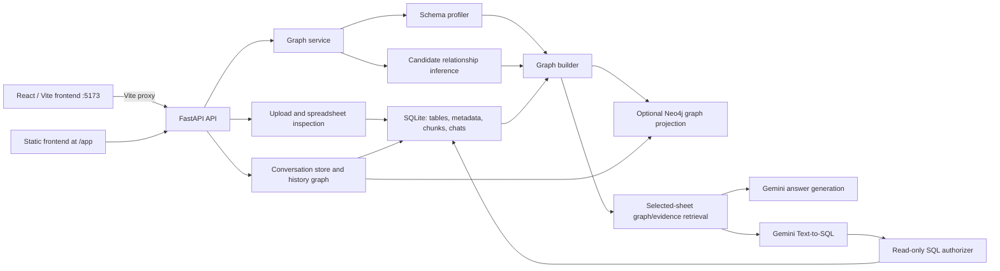

# GraphSheet AI Demonstration Readiness Report

**Audit date:** 2026-10-30  
**Final status: NOT READY FOR DEMONSTRATION**

## 1. Executive summary

The local, isolated backend suite passes (156 passed, one deprecation warning),
and the React frontend passes ESLint and its production build. An isolated
two-sheet workflow verified graph construction, candidate relationship
inference, graph-guided evidence retrieval, and read-only SQL totals.

The required core workflow is not fully demonstrated: the configured Neo4j
connection failed during the initial test run, and no live Gemini request was
made. Gemini-backed answers and model-generated SQL therefore remain
unverified. The application does not meet the requested READY criteria.

The repository already had extensive uncommitted changes before this audit.
Those changes were preserved. The audit added a test-isolation bootstrap and
fixed one answer-service ordering bug; it did not attempt to attribute or
rewrite the other existing worktree changes.

## 2. Overall architecture



FastAPI routes are in `backend/app/api/`. Spreadsheet parsing, persistence,
profiling, graph construction, retrieval, SQL validation, and provider
adapters are in `backend/app/services/`. The React/Vite source is in
`frontend/src/`; Vite proxies API paths to the backend. The backend also mounts
a separate framework-free client from `backend/app/static/` at `/app/`.

The actual Neo4j projection uses `GraphNode` and `GraphEdge` labels, storing
application node/relationship kinds as properties and connecting edge records
with `SOURCE` and `TARGET`. The API graph is reconstructed with typed
`Dataset`, `Column`, `Evidence`, and edge types. This is not a physical
Neo4j `Dataset -[:HAS_COLUMN]-> Column` representation.

## 3. Backend code audit

- The inspected API routes validate request fields with Pydantic and return
  explicit validation/not-found/service errors.
- Spreadsheet upload streams to a temporary file, limits uploads to 10 MB,
  checks the filename extension, and removes the temporary file afterward.
- SQLite is the source of truth for full spreadsheet tables and metadata.
- Conversation events preserve questions, answers, selected datasets, SQL,
  execution status, and result references in SQLite.
- The SQL service opens SQLite read-only, authorizes permitted operations,
  validates registered selected tables, limits runtime and result sizes, and
  records read-column provenance.
- Regression tests cover upload validation, conversation isolation, graph
  limits, and SQL write/table-scope rejection.
- The full suite now passes with provider configuration isolated. One
  Starlette deprecation warning remains.

## 4. Frontend code audit

- React/Vite lint and production build both pass.
- The React navigation labels are Overview, Datasets, AI Analyst, SQL Studio,
  Knowledge Graph, and Settings. Upload is part of the Datasets workflow; there
  is no separate tab named "Upload Spreadsheet".
- API helpers validate expected response shapes and surface HTTP errors.
- The FastAPI `/app/` route serves the separate static client in
  `backend/app/static/`, not the React/Vite build. The React app is served by
  the Vite development server; no production wiring from `frontend/dist` to
  FastAPI was demonstrated.
- No browser session or screenshots were captured. React UI rendering,
  navigation, reload persistence, loading/error states, and visual behavior
  were not verified in a browser.

## 5. Neo4j connection and graph structure

The initial ordinary pytest run loaded the local provider configuration and
attempted Neo4j operations. Those operations failed with a routing/connection
error before graph results were returned. No read-only Cypher inventory,
live node/relationship counts, live schema inspection, or graph-rebuild
duplicate check was completed. Subsequent test runs disable dotenv loading and
do not contact Neo4j.

The local isolated SQLite graph check produced:

- 2 `Dataset`, 6 `Column`, and 2 `Evidence` nodes.
- 6 `HAS_COLUMN`, 2 `HAS_EVIDENCE`, and 1 `CANDIDATE_MATCH` edges.
- A `customer_id` candidate with 3 shared values and heuristic confidence
  1.0. It is a candidate, not a verified foreign key.

To establish live Neo4j readiness, confirm the configured Aura URI, username,
password, database, network access, and TLS compatibility locally. Do not put
the secret values in reports or logs. Then run read-only inventory queries and
verify that a rebuild is idempotent.

## 6. Relationship inference

Inference compares normalized column names and distinct values, requiring at
least two shared values and a minimum overlap. The isolated customers/orders
fixture discovered the intended `customer_id` relationship. It remains a
heuristic candidate.

The inference implementation fingerprints full table contents and
materializes/sorts serialized rows. No performance benchmark was run; this is
a potential memory/time bottleneck as row counts grow.

## 7. Graph RAG validation

Code and mocked tests show the chat path builds selected-sheet graph context,
retrieves evidence chunks, includes retrieved spreadsheet evidence and
selected graph context in the Gemini prompt, and returns source metadata.
Tests also verify that unselected dataset evidence and sample values are not
passed into the answer prompt.

The isolated two-sheet fixture returned evidence from both selected datasets
and verified selected-dataset retrieval isolation. A cross-sheet relationship
was found. This validates the local retrieval/prompt construction path, not a
live generated answer. No live Gemini response or end-to-end graph-to-Gemini
influence was observed.

## 8. Gemini integration

No genuine Gemini request was sent. The automated answer tests use mocked
clients, and the isolated data test intentionally stopped before any provider
call. API key availability does not establish model access, quotas, model
compatibility, response handling, or network connectivity. Live Gemini
integration is **BLOCKED / UNVERIFIED**.

## 9. Text-to-SQL

Automated tests cover SQL validation, dataset scoping, aggregation, CTEs,
multiple selected tables, and rejection of writes, multiple statements,
unapproved functions, unselected tables, oversized results, and missing
databases. The isolated two-sheet test ran a manually specified read-only JOIN
and matched the expected totals:

| Customer | Sales |
|---|---:|
| Amit | 500 |
| Priya | 2,000 |
| Rahul | 2,500 |
| **Total** | **5,000** |

This proves SQL execution and safety for the fixture, not Gemini-generated
SQL. No live model-generated SELECT/COUNT/SUM/AVG/GROUP BY/ORDER BY/FILTER/JOIN
matrix was run.

## 10. API and frontend integration

FastAPI `TestClient` tests passed for health, upload validation, preview/schema,
relationship and graph responses, conversation graph/selection, and mocked
Text-to-SQL routes. Their mocked provider/service cases are not live service
integration tests. No separate live HTTP server, browser, or React API session
was run.

The React build succeeds, but `/app/` serves the framework-free static client.
Confirm whether the React build is intended to replace or coexist with this
route before a production-style mentor demonstration.

## 11. End-to-end testing

The isolated local test created temporary customers/orders CSVs and a
temporary SQLite database, constructed the graph, inferred the cross-sheet
candidate, retrieved two evidence chunks, and executed a scoped read-only JOIN.
Expected per-customer totals and total sales matched. Four write statements
were rejected. Temporary files were removed.

The following requested live steps remain unverified: actual file upload
through a running app, Neo4j graph synchronization/query, a real Gemini answer,
Gemini SQL generation, React browser rendering, reload persistence through the
UI, and a second-chat isolation demonstration.

## 12. Automated tests, lint, build, and coverage

| Check | Result |
|---|---|
| Backend suite | 156 passed, 0 failed, 1 Starlette deprecation warning |
| Frontend ESLint | Passed |
| Frontend production build | Passed; 619.56 kB minified JS chunk warning (190.28 kB gzip) |
| `git diff --check` | Passed |
| Frontend automated test script | Not configured |
| Type checking | No configured command run |
| Coverage | Not measured |
| Live Neo4j | Connection attempt failed; no live graph verification |
| Live Gemini | Not attempted; mocked tests only |
| Browser/screenshots | Not run/captured |

## 13. Performance and security findings

- **Security limitation:** the README explicitly states the application has no
  authentication, authorization, or multi-user isolation. Keep it bound to
  localhost and do not expose it to an untrusted network.
- **SQL controls:** read-only mode, authorizer, selected-table checks, limits,
  and write rejection are covered by tests and the isolated workflow.
- **Provider data:** Gemini workflows send the selected question plus retrieved
  evidence or selected schema to the configured provider, as documented in the
  README. Do not use sensitive spreadsheets without an appropriate data
  handling decision.
- **Performance:** no load/performance benchmark was run. Full-table
  fingerprinting in relationship inference is a potential scaling constraint.
- `.env` values were not printed or added to reports. No databases or user
  spreadsheet files were deleted or overwritten.

## 14. Bugs discovered and fixes applied

1. **Fixed:** the answer service required a Gemini API key before returning its
   deterministic `no_evidence` result. The key/model checks now occur only
   after confirming there is evidence. Existing regression test covers this.
2. **Fixed:** pytest loaded local `.env` provider settings and attempted
   external Neo4j operations. A test bootstrap disables dotenv and clears
   provider variables before test imports; tests can still opt into fake
   values and mocked clients. The ordinary backend test command now passes
   without contacting provider services.
3. **Open operational blocker:** Neo4j connection was unavailable during the
   initial configured run; live schema and idempotence remain unverified.
4. **Open operational blocker:** Gemini live integration remains unverified.
5. **Known limitation:** no authentication/multi-user controls; use locally
   only.

See [the bug tracker](./GRAPHSHEET_AI_BUG_TRACKER.md) for root causes and
statuses.

## 15. Files modified during this audit

- `backend/app/services/answer_service.py` — defer Gemini configuration checks
  until evidence exists.
- `backend/tests/conftest.py` — isolate test runs from real provider settings.
- `README.md` — document provider-safe test setup and frontend check commands.
- `reports/GRAPHSHEET_AI_DEMONSTRATION_READINESS_REPORT.md`
- `reports/GRAPHSHEET_AI_DEMO_CHECKLIST.md`
- `reports/GRAPHSHEET_AI_BUG_TRACKER.md`
- `reports/GRAPHSHEET_AI_API_TEST_RESULTS.md`

Other modified and untracked files were already present in the worktree and
were preserved. No database changes were made.

## 16. Exact validation commands

Run from the repository root:

```powershell
.\.venv\Scripts\python.exe -m pytest backend\tests -q
npm --prefix frontend run lint
npm --prefix frontend run build
git --no-pager diff --check
```

The two-sheet verification used an ephemeral PowerShell here-string piped to
`.\.venv\Scripts\python.exe -`; it created and removed an isolated SQLite
database under `%TEMP%`. It did not use the project database or call Gemini
or Neo4j.

## 17. Mentor demonstration instructions

Do not present the core AI workflow as live-verified until both external
services are checked. After resolving them, run the script in
[the demo checklist](./GRAPHSHEET_AI_DEMO_CHECKLIST.md). Keep the backend
bound to `127.0.0.1`, use the sample CSVs only, and verify source evidence,
graph candidate status, and the generated SQL result in front of the mentor.

## 18. Final readiness decision

**NOT READY FOR DEMONSTRATION.** The offline upload/data/graph/retrieval/SQL
components have strong automated and isolated-fixture evidence, but required
live Neo4j connectivity failed and the Gemini answer/Text-to-SQL workflow was
not live-tested. These gaps prevent satisfying the stated core workflow
criteria.
